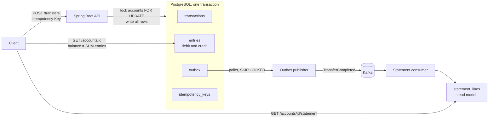

# ledger-service

A small payments ledger: accounts, double-entry transfers, derived balances and a transaction history. It is the kind of core that sits under a wallet or payment app, built at small scale to show the parts that are hard to get right: money types, concurrency, idempotent APIs and reliable event publishing.

Java 17, Spring Boot 3.5, PostgreSQL, Kafka, Flyway, Testcontainers.

## What it does

- Create accounts in any ISO 4217 currency.
- Deposit money from an external account and transfer it between accounts. Every movement is one transaction with two entries (debit and credit) that always sum to zero.
- A balance is never stored. It is the sum of an account's entries.
- Reject insufficient funds and currency mismatches with RFC 7807 problem details.
- Make retries safe with an `Idempotency-Key` header.
- Publish a `TransferCompleted` event to Kafka for every posted transaction, and build a per-account statement view from those events.

## Architecture



The transfer, its entries, its idempotency key and its outbox event commit together or not at all. Kafka is only touched afterwards, by the poller.

## Run it

You need Java 17 and Docker.

```bash
docker compose up -d                      # Postgres and Kafka
./gradlew bootRun
```

If port 5432 is already taken on your machine:

```bash
POSTGRES_PORT=5433 docker compose up -d
DB_URL=jdbc:postgresql://localhost:5433/ledger ./gradlew bootRun
```

Then open:

- Swagger UI: http://localhost:8080/swagger-ui/index.html
- Health: http://localhost:8080/actuator/health
- Metrics: http://localhost:8080/actuator/prometheus

Run the tests (needs Docker for Testcontainers):

```bash
./gradlew test
```

## API examples

Amounts are integers in minor units (paise for INR), never decimals.

```bash
H='Content-Type: application/json'

# Two accounts
A=$(curl -s -X POST localhost:8080/accounts -H "$H" -d '{"owner":"Asha","currency":"INR"}' | jq -r .id)
B=$(curl -s -X POST localhost:8080/accounts -H "$H" -d '{"owner":"Ravi","currency":"INR"}' | jq -r .id)

# Put 100.00 INR into A
curl -s -X POST localhost:8080/accounts/$A/deposits -H "$H" -d '{"amount":10000}'

# Move 30.00 INR from A to B, safe to retry with the same key
K=$(uuidgen)
curl -s -X POST localhost:8080/transfers -H "$H" -H "Idempotency-Key: $K" \
  -d "{\"fromAccountId\":\"$A\",\"toAccountId\":\"$B\",\"amount\":3000}"

# Balance of A is 7000
curl -s localhost:8080/accounts/$A

# History, newest first, paginated
curl -s "localhost:8080/accounts/$A/statement?page=0&size=20"
```

Errors are problem+json with a stable `type` that clients can branch on:

```json
{"type":"/problems/insufficient-funds","title":"Unprocessable Entity","status":422,
 "detail":"Account 3f... has balance 7000, transfer needs 999999","instance":"/transfers"}
```

| Situation | Status | `type` |
|---|---|---|
| Malformed body, amount <= 0, bad currency | 400 | (validation) |
| Transfer to the same account | 400 | `same-account` |
| Unknown account | 404 | `account-not-found` |
| Insufficient funds | 422 | `insufficient-funds` |
| Currency mismatch | 422 | `currency-mismatch` |
| Idempotency key reused with a different body | 409 | `idempotency-key-reused` |

## Design decisions

**Money is `long` minor units.** `double` cannot represent most decimal fractions exactly, and the errors add up across a ledger. Integers are exact and fast to sum, and payment APIs such as Stripe and Razorpay use the same convention. The cost is that an amount means nothing without its currency, which tells you where the decimal point goes.

**Balance is derived, not stored.** Entries are the single source of truth, so a balance can never disagree with the history. The cost is a `SUM` per read. At scale the fix is a cached balance written in the same transaction, or periodic snapshots, with the entries staying authoritative.

**Double entry.** Each transaction has a debit and a credit entry, and the entries of a transaction sum to zero. Money enters only through deposits, which debit a per-currency external account that is allowed to go negative. Transfers only move money, so the sum of all entries in the ledger is always zero.

**Pessimistic locking.** A transfer locks both account rows with `SELECT ... FOR UPDATE` before it checks the balance, so the check and the write act as one step. Under READ COMMITTED each statement sees fresh data, so the second transfer sees the first one's entries once it gets the lock. Optimistic locking would fail and retry under contention, and a ledger has hot accounts, so queueing on a lock is cheaper than redoing work. Both rows are locked in one query ordered by id, so opposing transfers (A to B and B to A) cannot deadlock. A naive "lock from, then lock to" version deadlocked in testing.

**Idempotency.** The key is claimed with `INSERT ... ON CONFLICT DO NOTHING` on a primary key, inside the same transaction as the transfer. A concurrent duplicate blocks on that insert until the first request commits, then replays the stored response. A different request body with the same key gets a 409 (the body is compared by SHA-256 hash). A failed request rolls the key back with everything else, so a retry runs fresh. The header is optional, as in Stripe's API.

**Transactional outbox.** Publishing to Kafka after the commit can lose the event if the app crashes in between, and publishing before the commit can announce a transfer that never happened. Instead the event is a row in the same transaction as the entries, and a poller publishes it afterwards using `FOR UPDATE SKIP LOCKED`, so several instances can share the work. Delivery is at least once, so the consumer must be idempotent: the statement view has a primary key on `(account_id, transaction_id)` and ignores duplicates.

**Statement view is eventually consistent.** It can lag the ledger by about a second, which is fine for a history screen. The funds check never reads it. It reads the entries under a row lock.

**Pagination is offset based.** It is simple and enough here. Keyset pagination is the upgrade for long histories, because offset gets slower on deep pages and shifts when rows are inserted.

## Test strategy

33 tests: 27 integration tests against real PostgreSQL and Kafka in Testcontainers, and 6 Mockito unit tests for the transfer rules.

- **Why not H2:** locking, `ON CONFLICT` and isolation behave differently from Postgres, so an H2 test would not test the database that ships.
- **Concurrency:** 100 parallel transfers against a balance that allows exactly 50, expecting exactly 50 successes and a final balance of zero. Without locking this test failed (58 succeeded and the account went negative). A second test sends opposing transfers in parallel to prove there is no deadlock.
- **Idempotency:** replay, a conflicting body, a failed attempt freeing its key, and 10 concurrent retries with one key moving money once.
- **Outbox and consumer:** an end-to-end path through real Kafka, a failed transfer writing no event, and a redelivered event being ignored.
- **Coverage:** JaCoCo reports about 92% line and branch coverage (`build/reports/jacoco/test/html/index.html`). Coverage shows what is untested, not what is well tested.

## Container images

Three builds of the same jar, scanned with Trivy 0.75.0 on 2026-10-20 (the CI gate pins Trivy 0.69.1). Raw reports are in [results/](results/).

| Image | Base | Size | Runs as | CVEs (critical / high / total) |
|---|---|--:|---|--:|
| [Dockerfile.basic](Dockerfile.basic) | `eclipse-temurin:17-jdk-noble`, single stage | 505 MB | root | 2 / 0 / 125 |
| [Dockerfile](Dockerfile) | `eclipse-temurin:17-jre-noble`, multi-stage, layered, healthcheck | 348 MB | uid 10001 | 2 / 0 / 53 |
| [Dockerfile.chiselled](Dockerfile.chiselled) | `ubuntu/jre:17-24.04_stable` (chiselled) | 223 MB | uid 584792 | 2 / 3 / 17 |

Build and run:

```bash
./gradlew bootJar
docker build -t ledger-service .
docker run --network host -e DB_URL=jdbc:postgresql://localhost:5432/ledger ledger-service
```

What the numbers show:

- **The base image decides the OS CVEs.** Operating system package findings go from 121 (JDK image) to 49 (JRE image) to 0 (chiselled). The chiselled image has no shell and no package manager, so it also gives an attacker less to work with. The cost is that `HEALTHCHECK` with curl and `docker exec sh` are not available.
- **The base image cannot fix application CVEs.** Before dependency updates all three images had the same 5 critical findings, because they live in the jar (Tomcat, Spring, Jackson), not in the OS. Bumping Tomcat, Jackson, the Postgres driver and lz4 removed 3 of them and every HIGH finding in the jar.
- **Known remaining issue:** 2 critical CVEs in `spring-webmvc` 6.2.19. Spring's 6.2 line has no fixed release, and the fix is in Spring 7, which means Spring Boot 4. This project stays on Boot 3.5 on purpose.
- **Pebble on the chiselled image:** the 3 HIGH findings are in Pebble, a Go binary bundled in the base image. The app does not run it, and the fix has to come from a newer base image tag.
- The dependency overrides in [build.gradle.kts](build.gradle.kts) should be removed once Spring Boot ships those versions.

## Observability

- JSON logs (Elastic Common Schema) with a `requestId` on every line. A safe `X-Request-Id` from the client is reused, otherwise one is generated, and it is returned in the response.
- Micrometer metrics at `/actuator/prometheus`, including `ledger_transactions_posted_total{type}`.

## Known limits

- Idempotency keys and published outbox rows are never deleted. A cleanup job is needed before real traffic.
- Unparseable events are skipped without a dead-letter topic. (The outbox backlog is exported as the `ledger.outbox.backlog` gauge.)
- No authentication. Swagger UI and API docs are on by default and should be disabled in production.
- Every connection sets `lock_timeout = '5s'`, so a transfer waiting on a stuck row lock fails instead of hanging, but it currently surfaces as a generic 500 rather than a retryable error.
